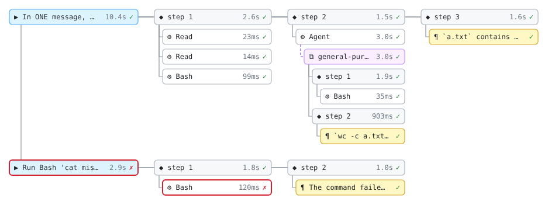

# claude-dag

A Claude Code mod that draws a live, persistent graph of a session: each turn, the
model requests (steps) inside it, the text and thinking blocks, the tool calls, and the
subagents spawned, with the edges between them.



## Install

```
/plugin install dag --marketplace matheusbsilva/claude-dag
```

Answer `y` to add the marketplace, then pick a scope. Requires Claude Code 2.1.287 or
later (mods on by default).

## Use

| Command | What it does |
| --- | --- |
| `/dag` | Open the graph pane, or close it when it is open |
| `/dag off` | Stop capturing for this session and close the pane; the choice survives `/resume` |
| `/dag on` | Resume capturing, backfilling the gap from the transcript |
| `/dag export json` | Write the graph (`DagFile`, schema v1) as JSON |
| `/dag export svg` | Write the whole graph as an SVG image |
| `/dag export png` | Convert the SVG with `rsvg-convert` or `resvg` when one is on `PATH`; otherwise write the SVG and say so |

On the desktop app (and VS Code) the pane draws the graph as an SVG: turns run top to
bottom, each turn's steps left to right with their tool calls stacked under them, and a
subagent under the Agent call that spawned it. Hovering a box shows its details. In the
terminal the pane draws the same graph as an indented tree with status marks
(`…` running, `✓` ok, `✗` error, `⊘` denied or interrupted) and durations. A picker
under the graph shows any node's input, result, duration and token usage.

## Where things are kept

- The graph of each session: `<project>/.claude/dag/<sessionId>.json`. It's a cache: a
  resumed session reloads it, and a session without one (a fork, `/branch`, a deleted
  file) is rebuilt from the transcript. You'll probably want `.claude/dag/` in your
  `.gitignore`.
- Exports: `<project>/.claude/dag/exports/<sessionId>-<timestamp>.{json,svg,png}`.
- The per-session on/off choice lives in the mod's store with the path of each graph file.

`/clear` starts a new, empty graph. The previous session's graph stays on disk.

## Settings

Set these in the config menu or under `pluginConfigs.dag` in settings.

| Field | Default | Meaning |
| --- | --- | --- |
| `windowTurns` | `10` | Turns shown in the pane; older ones fold into one summary node |
| `maxDetailChars` | `500` | Tool inputs, results and texts are truncated to this length |
| `excludedTools` | `""` | Comma-separated tool names that are never captured |
| `exportDir` | `""` | Export folder; empty means `<project>/.claude/dag/exports` |
| `dataDir` | `""` | Graph folder; empty means `<project>/.claude/dag` |

## Limits

- **Thinking content:** Claude Code passes thinking blocks to mods without their text,
  so a thinking node shows only that the model thought.
- **Rebuilt graphs:** a graph rebuilt from the transcript (or backfilled by `/dag on`)
  has no timings for the turns it rebuilt. Subagent internals return only when the live
  graph still holds them.
- **Long sessions:** a graph file is kept under the 4 MiB file limit. If needed, the
  details of turns outside the pane's window are dropped first, then the oldest turns.
  The SVG export falls back to the most recent turns the same way.
- **Managed settings:** the mod doesn't load under `allowManagedModsOnly` or
  `allowManagedHooksOnly` unless your organization installs it.

## Develop

```
claude plugin validate --strict .
tsc -p .                 # needs .claude-plugin/types, laid by Claude Code when it loads the mod
claude plugin test .
claude --plugin-dir .    # try it in a session; edits hot-reload
```

`hooks/register.tsx` wires the hooks to a pure reducer (`hooks/reduce.ts`). The live
graph is held in `$.state`, and the pane (`hooks/pane.tsx`), the file and the exports
all read from it. `hooks/layout.ts` and `hooks/svg.ts` are shared by the pane and the
SVG export. The test fixtures in `tests/fixtures/` are distilled from real hook payloads
recorded on Claude Code 2.1.296.
